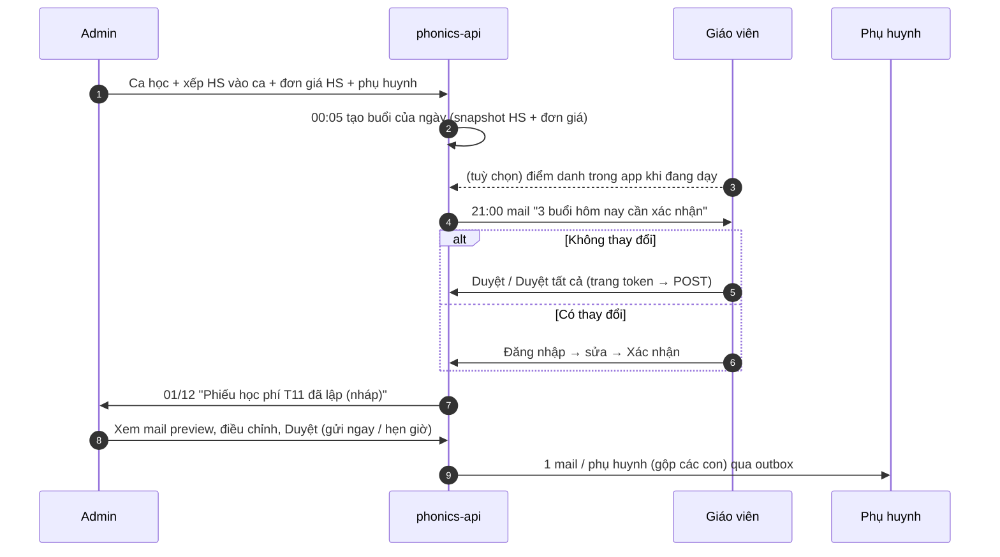
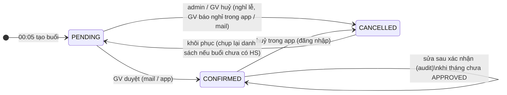
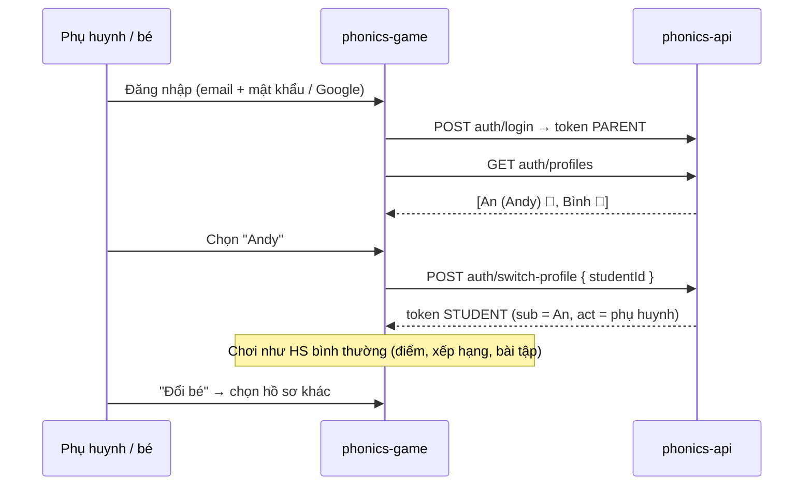
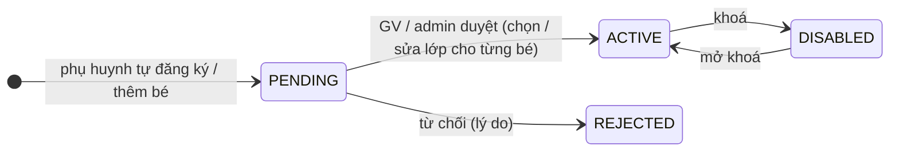

# Thiết kế: Học thêm — ca học, điểm danh, xác nhận của GV, học phí tháng, phụ huynh

Trạng thái: **đề xuất v3** (chưa code). Phạm vi: phonics-api (+ contracts) và phonics-admin.

## 0. Lịch sử thay đổi

### v3 (theo phản hồi vòng 2)

| # | Phản hồi | Thay đổi |
| --- | --- | --- |
| 1 | Vắng **không tính tiền** | `BILLING_POLICY`: chỉ `PRESENT` tính phí; `ABSENT` / `EXCUSED` không (admin vẫn ghi đè từng bản ghi được) |
| 2 | Chưa có giá theo HS × ca, nhưng thiết kế để mở rộng | Bảng đơn giá `extra_rates` có `slot_id` **tuỳ chọn** + giá mặc định của ca; thứ tự ưu tiên cố định (§4.1). Hôm nay chỉ dùng giá theo HS / ca, sau này thêm giá HS × ca không cần migrate |
| 3 | Phụ huynh thứ hai nhận **cc** | Giữ: mail học phí gửi người nhận học phí, cc guardian `receives_reports` |
| 4 | Thông tin chuyển khoản **đặt trong template** | Bỏ biến cấu hình `center.paymentInfo`; admin viết thẳng STK vào template; hệ thống cấp biến `payment.reference` (nội dung chuyển khoản sinh tự động) |
| 5 | GV **xem & tự setup đơn giá** cho ca mình | Quyền `extra.viewPricing` / `extra.managePricing` mặc định ADMIN + TEACHER, **scope theo ca GV dạy**; GV đặt giá mặc định của ca + giá riêng từng HS trong ca (§6.2) |
| 6 | Tài khoản phụ huynh **cũng là** tài khoản HS (bé không tự tạo tài khoản) | **Tài khoản gia đình**: phụ huynh đăng nhập 1 lần → chọn hồ sơ bé → chơi; HS "được quản lý" không cần email; công cụ chuyển dữ liệu cũ; tài khoản PH đưa lên làm sớm (§10) |
| 7 | HS có tên tiếng Việt + tên tiếng Anh (tiếng Anh có thể trống) | `vietnamese_name` bắt buộc, `english_name` tuỳ chọn; bảng quy định dùng tên nào ở đâu (§3.4) |
| 8 | Tài khoản tự đăng ký **cần duyệt** | Trạng thái `PENDING` → admin duyệt (chọn lớp từng bé) / gộp / từ chối; chưa duyệt thì chưa vào lớp, chưa chơi (§10.7) |
| 9 | Không cần PIN phụ huynh | Bỏ PIN: "Đổi bé" / "Khu phụ huynh" mở thẳng (§10.3) |
| 10 | GV cũng **duyệt tài khoản** | `families.approve` = ADMIN + TEACHER, GV duyệt / từ chối bé đăng ký vào lớp mình; gộp hộ chỉ admin (§10.7) |
| 11 | GV **được xem** email / SĐT phụ huynh | `students.viewParentContact` mặc định ADMIN + TEACHER, scope HS lớp / ca GV dạy; GV gộp hộ được khi hộ có sẵn có con trong lớp mình (§3.3, §10.7) |

### v2 (theo phản hồi vòng 1)

| # | Phản hồi | Thay đổi trong thiết kế |
| --- | --- | --- |
| 1 | Học phí = đơn giá **từng học sinh** × số buổi; dữ liệu **đi theo học sinh**; cấp **tài khoản phụ huynh** theo học sinh | Đơn giá có lịch sử theo HS (`student_extra_rates`), mỗi bản ghi điểm danh chốt đơn giá lúc tạo; phiếu học phí tháng theo HS; thêm thực thể **Phụ huynh** (§3) + tài khoản `PARENT` (§10) |
| 2 | Gửi mail GV lúc **21:00** cùng ngày học | Mỗi tối 21:00 gửi **1 mail tổng hợp / GV / ngày** cho mọi buổi trong ngày (§5.2) |
| 3 | Token trong mail theo đề xuất | Link mail chỉ **duyệt nhanh**; sửa phải đăng nhập |
| 4 | Quản lý theo học sinh kèm mail phụ huynh | Nghiên cứu 3 hướng, chọn **Guardian N–N với học sinh** (§3); mail tháng gộp theo phụ huynh (anh chị em 1 mail) |
| 5 | Tách khỏi lớp: cùng lớp nhưng HS không học cùng buổi | Bỏ gắn lịch vào `Class`. Thực thể riêng **Ca học thêm** (`extra_slots`); **mỗi HS tự đăng ký những ca mình học** (§4) |
| 6 | Template mail phụ huynh, review trước khi gửi | Bảng `mail_templates` có phiên bản + editor + preview dữ liệu thật + gửi thử; màn duyệt học phí xem **đúng mail** từng phụ huynh trước khi gửi (§8) |
| 7 | GV sửa lịch học của HS khi sai sót; đơn giá theo từng HS | GV sửa ca của HS trong ca mình dạy, có hiệu lực từ ngày (kể cả quá khứ chưa khoá), tự đồng bộ buổi liên quan (§6). Đơn giá chỉ admin sửa |

## 1. Luồng tổng quát

1. **Admin** tạo **ca học thêm** (thứ, giờ, GV phụ trách) — độc lập với lớp chính.
2. **Admin / GV** xếp **từng học sinh** vào các ca HS học (HS A: T3 + T5; HS B: chỉ T5). Admin / GV đặt **đơn giá / buổi
   riêng** cho từng HS (hoặc giá mặc định của ca) và gắn **phụ huynh** (email nhận học phí).
3. **00:05 mỗi ngày có ca**: tạo buổi điểm danh của ngày, danh sách = HS đang được xếp vào ca, mặc định *có mặt*. GV
   có thể điểm danh ngay trong app khi đang dạy.
4. **21:00**: mỗi GV nhận **1 mail** liệt kê các buổi trong ngày chưa xác nhận (kèm buổi cũ còn treo):
   - Không thay đổi → **"Duyệt"** từng buổi hoặc **"Duyệt tất cả"**.
   - Có thay đổi → **"Sửa"** → đăng nhập, đánh vắng / thêm HS / sửa lịch HS → xác nhận.
5. **Ngày 1 tháng sau**: hệ thống lập **phiếu học phí nháp** cho từng HS (số buổi × đơn giá + điều chỉnh), gộp theo
   phụ huynh. Admin xem trước **đúng mail** sẽ gửi, chỉnh, duyệt → gửi (ngay hoặc hẹn giờ).
6. **Tài khoản gia đình**: phụ huynh đăng nhập 1 lần trên game → chọn bé để học, hoặc vào khu phụ huynh xem
   lịch học, điểm danh, phiếu học phí của các con.



## 2. Quyết định chính

| Vấn đề | Quyết định | Lý do |
| --- | --- | --- |
| Lịch gắn vào đâu | **Ca học thêm** (`extra_slots`) riêng, HS đăng ký từng ca (`student_slot_assignments`, có từ ngày / đến ngày) | Cùng lớp nhưng HS học buổi khác nhau; HS chuyển lớp chính không ảnh hưởng học thêm |
| Thông tin đi theo HS | Đơn giá, ca, điểm danh, phiếu học phí, phụ huynh đều khoá theo `student_id` | Trang chi tiết HS là nơi xem đủ; đổi ca / đổi GV không mất lịch sử |
| Đơn giá | Bảng `extra_rates` có lịch sử (`effective_from`), phạm vi HS / ca / HS × ca, giải theo thứ tự ưu tiên (§4.1); mỗi `attendance_record` **chốt `unit_price`** lúc tạo | Đổi giá giữa tháng chỉ ảnh hưởng buổi sau; phiếu tính lại từ bản ghi là ra đúng; mở rộng giá HS × ca không đổi schema |
| Tính phí | Chỉ buổi **có mặt** | Phản hồi v3 #1 |
| Ai đặt giá | Admin: mọi giá. GV: giá của **ca mình dạy** (mặc định ca + riêng HS trong ca) | Phản hồi v3 #5 |
| Tiền | `Int` VND, không số lẻ | Không lỗi làm tròn |
| Tạo buổi | 00:05 ngày có ca, idempotent theo `(slot_id, date)` | GV điểm danh trong app được; 21:00 chỉ việc gửi mail |
| Mail GV | 1 mail / GV / ngày lúc 21:00, gồm buổi hôm nay + buổi cũ còn PENDING (tối đa 3 lần nhắc) | Gom thay vì mail từng buổi; tự nhắc mà không cần job riêng |
| Link mail | Token ngẫu nhiên (lưu sha256) gắn **1 mail tổng hợp**, chỉ duyệt các buổi trong mail, hết hạn 7 ngày; mở trang → POST | Bộ quét link Outlook / Gmail tự GET link |
| Phụ huynh | `guardians` + `student_guardians` (N–N), 1 người **nhận học phí** / HS | Anh chị em dùng chung phụ huynh → 1 mail; 2 phụ huynh / HS; nền cho tài khoản phụ huynh |
| Template | `mail_templates` có phiên bản, **LiquidJS** (sandbox, tự escape HTML) | Admin sửa được nội dung mà không chạy được code |
| Khoá | Kỳ học phí tháng đã **APPROVED** → khoá sửa điểm danh, ca HS, đơn giá trong tháng đó | Số đã gửi phụ huynh không lệch |
| Hẹn giờ | Timer theo mốc dữ liệu kế tiếp (khung `AssignmentsScheduler`), không cron quét dày | Quy ước hạ tầng của repo |
| Gửi mail | Outbox + `MailSender` (`log` / `smtp`) | Retry, chống trùng, có nhật ký, hẹn giờ gửi |

## 3. Quản lý theo học sinh kèm phụ huynh (nghiên cứu cho câu 4)

### 3.1. Hiện trạng

`student_profiles` có `parent_name`, `parent_email`, `parent_phone` — 1 liên hệ / HS, chép lại cho mỗi anh chị em,
không có tài khoản. Học sinh đăng nhập bằng `users.email` (**unique**), nhiều HS nhỏ dùng luôn email của bố mẹ.

### 3.2. Ba hướng

| | A. Giữ cột trên HS | **B. Guardian N–N (đề xuất)** | C. Hộ gia đình (Household) |
| --- | --- | --- | --- |
| Mô hình | 3 cột như hiện tại | `guardians` + `student_guardians` | `households` → HS + phụ huynh + tài khoản thanh toán |
| Anh chị em | Mỗi HS 1 mail, sửa email phải sửa nhiều nơi | Chung 1 guardian → **1 mail gộp** | 1 hoá đơn / hộ |
| 2 phụ huynh / HS | Không | Có (cờ nhận học phí, nhận báo cáo) | Có |
| Tài khoản phụ huynh | Không có chỗ gắn | `guardians.user_id` → `users` role `PARENT` | Gắn vào hộ |
| Giảm giá anh chị em, công nợ chung | Không | Làm được bằng điều chỉnh trên phiếu | Tự nhiên nhất |
| Chi phí | 0 | Vừa: 2 bảng + migrate dữ liệu cũ | Cao, thừa với quy mô hiện tại |

**Chọn B.** Nếu sau này cần công nợ / giảm giá theo hộ, thêm `households` phía trên guardian mà không phá B.

### 3.3. Luật

- `guardians.email` chữ thường, **unique khi khác null** → nhập email đã có thì gợi ý gắn guardian sẵn có (anh chị em
  tự gộp).
- Mỗi HS có đúng **1 guardian nhận học phí** (`is_billing_contact`, partial unique index); các guardian khác có thể
  `receives_reports` (nhận bản sao).
- Mail học phí gộp theo **guardian nhận học phí**: 1 mail liệt kê từng con + tổng.
- Xem liên hệ phụ huynh theo quyền `students.viewParentContact`, **đổi mặc định thành ADMIN + TEACHER** (phản hồi
  v3 #11). GV chỉ thấy liên hệ phụ huynh của HS trong **lớp chính hoặc ca học thêm mình dạy** (kiểm tra bằng
  `AccessService.assertStudentAccess` + phân công ca); admin thu hồi từng GV ở trang Phân quyền nếu cần. Thay đổi này
  áp luôn cho trang chi tiết HS hiện có (`StudentReaderService` đã đọc quyền này, chỉ đổi `defaultRoles` trong contracts).
- **Migrate**: mỗi `parent_email` khác null → 1 guardian (gộp theo email), gắn HS với `is_billing_contact = true`;
  HS chỉ có tên / SĐT → guardian không email (admin bổ sung). Giữ 3 cột cũ 1 phiên bản (chỉ đọc), sau đó xoá.
- **Trùng email với tài khoản HS**: được phép ở mức guardian (chỉ để nhận mail). Khi cấp tài khoản gia đình, công cụ
  chuyển đổi **chuyển thông tin đăng nhập** của HS sang tài khoản phụ huynh (§10.5) nên không còn xung đột.
- Lưu `phone` chuẩn hoá E.164 để sau này gửi Zalo ZNS / SMS nếu cần.

### 3.4. Tên học sinh: tiếng Việt + tiếng Anh (phản hồi v3 #7)

- `student_profiles.vietnamese_name` **bắt buộc** (họ tên đầy đủ có dấu), `english_name` **tuỳ chọn** (trim, rỗng →
  null). Migrate: `vietnamese_name = users.display_name` hiện tại, `english_name = null`.
- `users.display_name` của HS **không nhập tay nữa**: writer tự đặt = `english_name ?? vietnamese_name` mỗi lần sửa
  tên → xếp hạng, thông báo, game đang đọc `displayName` giữ nguyên code.
- Hàm dùng chung `studentNames(profile)` (contracts) trả `{ vi, en, display, full }`, với `full` =
  `"Nguyễn Văn An (Andy)"` hoặc `"Nguyễn Văn An"` khi không có tên tiếng Anh.

| Nơi hiển thị | Tên dùng |
| --- | --- |
| Game, xếp hạng, chọn hồ sơ bé | `display` (tên tiếng Anh nếu có) — màn chọn bé hiện thêm tên tiếng Việt nhỏ bên dưới |
| Admin: danh sách / chi tiết HS, trang buổi, ca | `full` — cột tên tiếng Việt + cột tên tiếng Anh, sort theo **tên** tiếng Việt (từ cuối) |
| Mail 21:00 cho GV | `full` |
| Phiếu học phí, mail phụ huynh, xlsx | Tên tiếng Việt (+ tên tiếng Anh trong ngoặc nếu có) |
| `payment.reference` | Tên tiếng Việt **in hoa không dấu** (ngân hàng không nhận dấu) |
| Tìm kiếm HS | Khớp cả hai tên, bỏ dấu (`unaccent` / cột chuẩn hoá) |

Contracts: `StudentView` thêm `vietnameseName`, `englishName`; body tạo / sửa HS nhận `vietnameseName` (bắt buộc),
`englishName` (tuỳ chọn, cho phép `null` để xoá) thay vì `displayName`. GV có `students.edit` sửa được cả hai tên.

## 4. Mô hình dữ liệu (file mới `prisma/schema/extra-lessons.prisma`, `guardians.prisma`, `billing.prisma`)

```prisma
// ===== Ca học thêm & xếp học sinh =====

/// Ca học thêm định kỳ hằng tuần, độc lập với lớp chính
model ExtraSlot {
  id         String    @id @default(uuid()) @db.Uuid
  /// "Phonics nâng cao — T3 18:00"
  name       String
  /// ISO weekday 1 = Thứ Hai … 7 = Chủ nhật
  weekday    Int
  /// 'HH:mm' theo APP_TIMEZONE. Sửa giờ chỉ ảnh hưởng buổi chưa tạo
  startTime  String    @map("start_time")
  endTime    String    @map("end_time")
  room       String?
  capacity   Int?
  /// Lớp chính tham khảo (để lọc), không bắt buộc
  classId    String?   @map("class_id") @db.Uuid
  archivedAt DateTime? @map("archived_at")
  createdAt  DateTime  @default(now()) @map("created_at")
  updatedAt  DateTime  @updatedAt @map("updated_at")

  teachers    ExtraSlotTeacher[]
  assignments StudentSlotAssignment[]
  sessions    AttendanceSession[]
  rates       ExtraRate[]

  @@index([weekday, archivedAt])
  @@map("extra_slots")
}

model ExtraSlotTeacher {
  slotId    String    @map("slot_id") @db.Uuid
  teacherId String    @map("teacher_id") @db.Uuid
  slot      ExtraSlot @relation(fields: [slotId], references: [id], onDelete: Cascade)
  teacher   User      @relation(fields: [teacherId], references: [id], onDelete: Cascade)

  @@id([slotId, teacherId])
  @@index([teacherId])
  @@map("extra_slot_teachers")
}

/// HS học ca nào, từ ngày nào đến ngày nào (lịch học của HS = tập các dòng đang hiệu lực)
model StudentSlotAssignment {
  id            String         @id @default(uuid()) @db.Uuid
  studentId     String         @map("student_id") @db.Uuid
  slotId        String         @map("slot_id") @db.Uuid
  /// 'YYYY-MM-DD'
  effectiveFrom String         @map("effective_from")
  /// null = đang học; ngày đầu tiên KHÔNG học nữa
  effectiveTo   String?        @map("effective_to")
  createdById   String         @map("created_by_id") @db.Uuid
  note          String?
  createdAt     DateTime       @default(now()) @map("created_at")
  updatedAt     DateTime       @updatedAt @map("updated_at")
  student       StudentProfile @relation(fields: [studentId], references: [userId], onDelete: Cascade)
  slot          ExtraSlot      @relation(fields: [slotId], references: [id], onDelete: Cascade)

  @@index([slotId, effectiveTo])
  @@index([studentId, effectiveTo])
  @@map("student_slot_assignments")
}

/// Đơn giá / buổi (VND), có lịch sử. Phạm vi theo cặp (student_id, slot_id):
///   (HS, ca)   = giá riêng HS ở ca đó        — chưa dùng ở v3, sẵn cho mở rộng
///   (HS, null) = giá riêng HS, mọi ca         — "đơn giá theo từng học sinh"
///   (null, ca) = giá mặc định của ca          — GV / admin setup cho ca
/// Không có dòng (null, null): thiếu giá thì unit_price = 0 + cảnh báo.
model ExtraRate {
  id              String          @id @default(uuid()) @db.Uuid
  studentId       String?         @map("student_id") @db.Uuid
  slotId          String?         @map("slot_id") @db.Uuid
  pricePerSession Int             @map("price_per_session")
  /// 'YYYY-MM-DD'; dòng mới cùng phạm vi tự đóng dòng cũ (effective_to = effective_from mới)
  effectiveFrom   String          @map("effective_from")
  effectiveTo     String?         @map("effective_to")
  createdById     String          @map("created_by_id") @db.Uuid
  note            String?
  createdAt       DateTime        @default(now()) @map("created_at")
  student         StudentProfile? @relation(fields: [studentId], references: [userId], onDelete: Cascade)
  slot            ExtraSlot?      @relation(fields: [slotId], references: [id], onDelete: Cascade)

  @@index([studentId, effectiveFrom])
  @@index([slotId, effectiveFrom])
  @@map("extra_rates")
}

// ===== Buổi & điểm danh =====

enum AttendanceSessionStatus {
  PENDING
  CONFIRMED
  CANCELLED
}

enum AttendanceMark {
  PRESENT
  ABSENT   // vắng không phép
  EXCUSED  // vắng có phép
}

model AttendanceSession {
  id             String                  @id @default(uuid()) @db.Uuid
  /// null = buổi bù admin tạo tay
  slotId         String?                 @map("slot_id") @db.Uuid
  date           String
  startsAt       DateTime                @map("starts_at")
  endsAt         DateTime                @map("ends_at")
  /// GV phụ trách lúc tạo buổi (chép từ ca; buổi bù chọn tay)
  teacherIds     String[]                @map("teacher_ids") @db.Uuid
  status         AttendanceSessionStatus @default(PENDING)
  presentCount   Int                     @default(0) @map("present_count")
  /// Tăng mỗi lần sửa records — duyệt qua mail chỉ hợp lệ khi bằng giá trị lúc gửi
  recordsVersion Int                     @default(0) @map("records_version")
  /// Số mail 21:00 đã nhắc buổi này
  digestCount    Int                     @default(0) @map("digest_count")
  confirmedById  String?                 @map("confirmed_by_id") @db.Uuid
  confirmedAt    DateTime?               @map("confirmed_at")
  /// 'EMAIL' | 'APP'
  confirmedVia   String?                 @map("confirmed_via")
  cancelReason   String?                 @map("cancel_reason")
  note           String?
  createdAt      DateTime                @default(now()) @map("created_at")
  updatedAt      DateTime                @updatedAt @map("updated_at")
  slot           ExtraSlot?              @relation(fields: [slotId], references: [id], onDelete: SetNull)
  records        AttendanceRecord[]

  @@unique([slotId, date])
  @@index([status, date])
  @@index([date])
  @@map("attendance_sessions")
}

model AttendanceRecord {
  sessionId     String            @map("session_id") @db.Uuid
  studentId     String            @map("student_id") @db.Uuid
  mark          AttendanceMark    @default(PRESENT)
  /// Đơn giá chốt lúc thêm vào buổi (VND)
  unitPrice     Int               @map("unit_price")
  /// Dòng extra_rates đã dùng (null = thiếu giá) — để truy vết và tính lại khi sửa giá hồi tố
  rateId        String?           @map("rate_id") @db.Uuid
  /// Có tính tiền buổi này không — mặc định theo BILLING_POLICY[mark], admin ghi đè được
  charged       Boolean
  /// 'SNAPSHOT' (từ lịch HS) | 'MANUAL' (GV thêm: học bù / học thử)
  source        String
  note          String?
  updatedById   String?           @map("updated_by_id") @db.Uuid
  updatedAt     DateTime          @updatedAt @map("updated_at")
  session       AttendanceSession @relation(fields: [sessionId], references: [id], onDelete: Cascade)
  student       StudentProfile    @relation(fields: [studentId], references: [userId], onDelete: Cascade)

  @@id([sessionId, studentId])
  @@index([studentId])
  @@map("attendance_records")
}

/// Một mail 21:00 gửi 1 GV — token duyệt nhanh gắn vào đây
model AttendanceDigest {
  id          String    @id @default(uuid()) @db.Uuid
  teacherId   String    @map("teacher_id") @db.Uuid
  date        String
  tokenHash   String    @unique @map("token_hash")
  expiresAt   DateTime  @map("expires_at")
  /// [{ sessionId, recordsVersion }] lúc gửi
  items       Json
  createdAt   DateTime  @default(now()) @map("created_at")

  @@unique([teacherId, date])
  @@map("attendance_digests")
}

// ===== Phụ huynh =====

enum GuardianRelation {
  MOTHER
  FATHER
  GRANDPARENT
  OTHER
}

model Guardian {
  id        String   @id @default(uuid()) @db.Uuid
  fullName  String   @map("full_name")
  /// chữ thường; partial unique khi khác null (thêm tay trong migration)
  email     String?
  /// E.164
  phone     String?
  /// Tài khoản gia đình (role PARENT, §10)
  userId    String?  @unique @map("user_id") @db.Uuid
  note      String?
  createdAt DateTime @default(now()) @map("created_at")
  updatedAt DateTime @updatedAt @map("updated_at")
  user      User?    @relation(fields: [userId], references: [id], onDelete: SetNull)
  students  StudentGuardian[]

  @@map("guardians")
}

model StudentGuardian {
  studentId        String           @map("student_id") @db.Uuid
  guardianId       String           @map("guardian_id") @db.Uuid
  relation         GuardianRelation @default(OTHER)
  /// Đúng 1 / HS (partial unique index `student_guardians_billing`)
  isBillingContact Boolean          @default(false) @map("is_billing_contact")
  /// Nhận bản sao (cc) mail tháng
  receivesReports  Boolean          @default(true) @map("receives_reports")
  /// Được vào hồ sơ bé bằng tài khoản gia đình (§10)
  canAccess        Boolean          @default(true) @map("can_access")
  student          StudentProfile   @relation(fields: [studentId], references: [userId], onDelete: Cascade)
  guardian         Guardian         @relation(fields: [guardianId], references: [id], onDelete: Cascade)

  @@id([studentId, guardianId])
  @@index([guardianId])
  @@map("student_guardians")
}

// ===== Học phí tháng =====

enum BillingPeriodStatus {
  DRAFT     // đã lập phiếu nháp, admin đang xem / chỉnh
  APPROVED  // đã duyệt, mail đã vào outbox (gửi ngay / hẹn giờ) — khoá tháng
}

enum StatementStatus {
  DRAFT
  APPROVED
  VOID      // huỷ (vd HS không còn buổi tính phí sau khi sửa)
}

model BillingPeriod {
  id            String              @id @default(uuid()) @db.Uuid
  /// 'YYYY-MM'
  month         String              @unique
  status        BillingPeriodStatus @default(DRAFT)
  generatedAt   DateTime            @map("generated_at")
  approvedById  String?             @map("approved_by_id") @db.Uuid
  approvedAt    DateTime?           @map("approved_at")
  /// Hẹn giờ gửi (null = gửi ngay khi duyệt)
  sendAt        DateTime?           @map("send_at")
  /// Phiên bản template dùng lúc duyệt
  templateId    String?             @map("template_id") @db.Uuid
  statements    StudentStatement[]

  @@map("billing_periods")
}

model StudentStatement {
  id              String          @id @default(uuid()) @db.Uuid
  periodId        String          @map("period_id") @db.Uuid
  studentId       String          @map("student_id") @db.Uuid
  /// Guardian nhận học phí lúc lập / duyệt
  guardianId      String?         @map("guardian_id") @db.Uuid
  status          StatementStatus @default(DRAFT)
  sessionsTotal   Int             @map("sessions_total")
  sessionsPresent Int             @map("sessions_present")
  sessionsCharged Int             @map("sessions_charged")
  /// Σ unit_price của buổi charged
  subtotal        Int
  /// [{ label, amount }] — giảm trừ (âm) / phụ thu (dương), vd giảm anh chị em, nợ tháng trước
  adjustments     Json            @default("[]")
  total           Int
  /// Snapshot dòng chi tiết từng buổi lúc duyệt [{ date, slotName, mark, unitPrice, charged }]
  lines           Json?
  note            String?
  createdAt       DateTime        @default(now()) @map("created_at")
  updatedAt       DateTime        @updatedAt @map("updated_at")
  period          BillingPeriod   @relation(fields: [periodId], references: [id], onDelete: Cascade)
  student         StudentProfile  @relation(fields: [studentId], references: [userId], onDelete: Cascade)

  @@unique([periodId, studentId])
  @@index([guardianId])
  @@map("student_statements")
}
```

Thay đổi bảng hiện có (`users.prisma`):

```prisma
enum Role {
  ADMIN
  TEACHER
  STUDENT
  PARENT // mới (§10)
}

enum UserStatus {
  ACTIVE
  DISABLED
  PENDING  // mới: tự đăng ký, chờ duyệt (§10.7)
  REJECTED // mới
}

enum LoginMode {
  OWN     // tự đăng nhập bằng email / Google (như hiện nay)
  MANAGED // chỉ vào qua tài khoản gia đình
}

model User {
  // ...
  /// null với HS MANAGED (unique vẫn giữ: Postgres cho nhiều null)
  email     String?   @unique
  loginMode LoginMode @default(OWN) @map("login_mode")
  guardian  Guardian?
  // ...
}

model StudentProfile {
  // ...
  /// Họ tên tiếng Việt — bắt buộc (§3.4)
  vietnameseName String  @map("vietnamese_name")
  /// Tên tiếng Anh — tuỳ chọn
  englishName    String? @map("english_name")
  // parent_name / parent_email / parent_phone: giữ chỉ đọc 1 phiên bản rồi xoá (§3.3)
  // ...
}
```

Hạ tầng mail (`mail.prisma` — đã làm ở PR 1):

```prisma
enum MailStatus {
  QUEUED
  SENT
  FAILED   // hết số lần thử
  SKIPPED  // không có địa chỉ
}

model MailOutbox {
  id            String     @id @default(uuid()) @db.Uuid
  /// 'teacher.digest' | 'parent.monthly' | 'parent.invite' | 'admin.billingReady'
  kind          String
  toEmail       String?    @map("to_email")
  cc            String[]
  subject       String
  /// Đã render sẵn lúc enqueue — nội dung admin đã xem trước là nội dung được gửi
  html          String
  text          String
  /// Chống gửi trùng: `digest:<teacherId>:<date>`, `monthly:<periodId>:<guardianId>:v<n>`
  dedupeKey     String     @unique @map("dedupe_key")
  refType       String?    @map("ref_type")
  refId         String?    @map("ref_id")
  status        MailStatus @default(QUEUED)
  attempts      Int        @default(0)
  nextAttemptAt DateTime   @default(now()) @map("next_attempt_at")
  lastError     String?    @map("last_error")
  sentAt        DateTime?  @map("sent_at")
  createdAt     DateTime   @default(now()) @map("created_at")

  @@index([status, nextAttemptAt])
  @@index([refType, refId])
  @@map("mail_outbox")
}

model MailTemplate {
  id          String   @id @default(uuid()) @db.Uuid
  /// 'parent.monthly' | 'teacher.digest' | 'parent.invite'
  key         String
  version     Int
  subject     String
  /// Liquid
  bodyHtml    String   @map("body_html")
  isActive    Boolean  @default(false) @map("is_active")
  createdById String   @map("created_by_id") @db.Uuid
  createdAt   DateTime @default(now()) @map("created_at")

  @@unique([key, version])
  @@map("mail_templates")
}
```

Index thêm tay trong migration:

```sql
CREATE UNIQUE INDEX guardians_email ON guardians (email) WHERE email IS NOT NULL;
CREATE UNIQUE INDEX student_guardians_billing ON student_guardians (student_id) WHERE is_billing_contact;
CREATE UNIQUE INDEX mail_templates_active ON mail_templates (key) WHERE is_active;
-- Ít nhất một trong hai phạm vi; mỗi phạm vi chỉ một dòng đang mở
ALTER TABLE extra_rates ADD CONSTRAINT extra_rates_scope CHECK (student_id IS NOT NULL OR slot_id IS NOT NULL);
CREATE UNIQUE INDEX extra_rates_open ON extra_rates
  (COALESCE(student_id, '00000000-0000-0000-0000-000000000000'), COALESCE(slot_id, '00000000-0000-0000-0000-000000000000'))
  WHERE effective_to IS NULL;
-- Một HS không có 2 dòng chồng nhau cho cùng ca: kiểm tra trong service (khoảng ngày), không dùng exclusion constraint
```

Luật snapshot: HS vào buổi `(slot, date)` khi có `student_slot_assignments` của ca đó với
`effective_from <= date < effective_to (hoặc null)` và tài khoản HS `ACTIVE`.

### 4.1. Giải đơn giá (`utils/rate.ts`, hàm thuần + spec)

`resolveRate(studentId, slotId, date)` lấy dòng `extra_rates` hiệu lực tại `date` theo thứ tự ưu tiên, gặp là dừng:

1. `(student_id = HS, slot_id = ca)` — giá riêng HS ở ca (mở rộng sau này)
2. `(student_id = HS, slot_id IS NULL)` — giá riêng HS
3. `(student_id IS NULL, slot_id = ca)` — giá mặc định của ca
4. Không có → `unit_price = 0`, `rate_id = null`, cảnh báo "HS chưa có đơn giá" trên trang buổi và màn học phí

Buổi bù (không có ca) và record MANUAL: dùng bước 2 → 0. Mở rộng giá HS × ca sau này chỉ cần **bật UI** cho bước 1;
schema, hàm giải và phiếu học phí không đổi.

`BILLING_POLICY` (contracts): `PRESENT → tính phí`, `ABSENT → không`, `EXCUSED → không`. Admin ghi đè `charged`
từng bản ghi (vd tính phí buổi vắng không báo trước theo thoả thuận riêng).

## 5. Vòng đời & hẹn giờ

### 5.1. `ExtraLessonsScheduler` (`modules/extra-lessons/jobs/`)

Khung giống `AssignmentsScheduler`. Mốc kế tiếp = min của:

| Mốc | Tính từ | Hành động |
| --- | --- | --- |
| **00:05** ngày có ca | `nextDateWithSlots(slots, now, tz)` (hàm thuần) | Upsert buổi cho mọi ca của ngày + snapshot records (idempotent theo `(slot_id, date)`) |
| **21:00** (`EXTRA_LESSONS.digestTime`) ngày có buổi PENDING (hôm nay hoặc cũ, `digest_count < 3`) | `min(date)` của buổi PENDING / ngày có ca | Gom buổi PENDING theo từng GV → 1 `attendance_digests` + 1 mail / GV, `digest_count++` |
| **00:10 ngày 1** | đầu tháng sau theo `TimeService` | Lập `billing_periods` + phiếu nháp tháng trước, notification + mail cho admin |

Writer gọi `scheduler.reschedule()` sau khi đổi ca / xếp HS / huỷ buổi / xác nhận. API khởi động lại → `tick()`
bù mọi mốc bị lỡ trong `EXTRA_LESSONS.catchUpDays` ngày (idempotent nhờ unique + dedupe key). Buổi quá 3 lần nhắc
vẫn PENDING → notification cho admin (dashboard "Buổi chưa xác nhận").



### 5.2. Mail 21:00 cho GV (`teacher.digest`)

```
Tiêu đề: [Phonics] Xác nhận điểm danh học thêm Thứ Ba 03/11 — 3 buổi

Chào cô Lan,
Hôm nay cô có 3 buổi học thêm cần xác nhận:

  Phonics nâng cao  17:00–18:30   12 HS (12 có mặt)          [Duyệt]  [Sửa]
  Đọc hiểu K2       18:45–20:00    8 HS (7 có mặt, 1 vắng)   [Duyệt]  [Sửa]
  Còn treo — 31/10 Phonics cơ bản  10 HS                     [Duyệt]  [Sửa]

            [ ✅ Duyệt tất cả 3 buổi ]
```

- **Duyệt / Duyệt tất cả** → `{ADMIN_APP_URL}/a/attendance/:token` (trang public) — `GET` hiển thị, nút bấm
  `POST /api/v1/attendance/public/digests/:token/confirm { sessionIds }`.
- Duyệt chỉ áp dụng buổi còn `PENDING`, GV là người dạy buổi đó, và `recordsVersion` = giá trị lúc gửi; khác →
  "Danh sách đã thay đổi, vui lòng bấm Sửa". Bấm lại buổi đã xác nhận → 200 "đã xác nhận lúc … bởi …".
- **Sửa** → `{ADMIN_APP_URL}/attendance/sessions/:id` (đăng nhập).
- Buổi có nhiều GV: ai xác nhận trước thì ghi nhận; mail của GV kia hiện "đã xác nhận".
- Không có buổi PENDING nào → không gửi.

## 6. Quyền của GV: sửa lịch HS và setup đơn giá

### 6.1. Sửa lịch học của HS

Màn **"Lịch học thêm của HS"** (trong trang chi tiết HS + trong trang ca). GV được làm, **trong phạm vi ca mình dạy**:

| Thao tác | Ý nghĩa | Dữ liệu |
| --- | --- | --- |
| Thêm HS vào ca từ ngày X | HS bắt đầu học ca này (X có thể ở quá khứ) | Tạo assignment `effectiveFrom = X` |
| Cho HS rời ca từ ngày Y | Nghỉ / bảo lưu | Đặt `effectiveTo = Y` |
| Chuyển HS sang ca khác của mình từ ngày Z | Đổi buổi | Đóng dòng cũ + mở dòng mới, 1 transaction |
| Sửa ngày bắt đầu / kết thúc bị nhập sai | Sửa sai sót | Sửa dòng (audit before / after) |

Sau mỗi thay đổi, service tính **các buổi bị ảnh hưởng** trong khoảng ngày đổi:

- Buổi **PENDING**: tự đồng bộ (thêm / bỏ record `SNAPSHOT`; record `MANUAL` giữ nguyên), `recordsVersion++`.
- Buổi **CONFIRMED** (tháng chưa khoá): trả danh sách cho UI → modal "Cập nhật luôn 3 buổi đã xác nhận?"; đồng ý thì
  sửa records + audit `attendance.updateRecords`.
- Ngày thuộc tháng **APPROVED**: chặn (409 `BILLING_PERIOD_LOCKED`) — chỉ admin mở khoá kỳ.

GV thêm HS vào ca mình bằng ô tìm HS trong các lớp chính mình dạy + HS đã từng ở ca mình (HS khác → nhờ admin).
Admin làm được mọi thao tác trên mọi ca.

### 6.2. Setup đơn giá (phản hồi v3 #5)

Quyền `extra.viewPricing` + `extra.managePricing` mặc định **ADMIN + TEACHER**; admin thu hồi từng GV ở trang Phân
quyền như các quyền khác. Scope kiểm tra trong service:

| Thao tác | GV (ca mình dạy) | Admin |
| --- | --- | --- |
| Đặt **giá mặc định của ca** `(null, ca)` | ✔ | ✔ |
| Đặt **giá riêng HS** `(HS, null)` | ✔ nếu **mọi** ca đang mở của HS đều do GV này dạy; HS học cả ca GV khác → nhờ admin (vì giá này áp cho mọi ca) | ✔ |
| Đặt giá HS × ca `(HS, ca)` | ✔ (khi bật UI mở rộng) | ✔ |
| Xem đơn giá / thành tiền | HS trong ca mình | Tất cả |
| Ghi đè `charged` / `unit_price` một bản ghi | ✖ | ✔ |

**Sửa giá có hiệu lực từ ngày trong quá khứ** (sửa sai sót) — xử lý giống đổi lịch ở §6.1:

- Ngày thuộc tháng **APPROVED** → chặn (409 `BILLING_PERIOD_LOCKED`).
- Trả về danh sách **buổi bị ảnh hưởng** (record có `rate_id` cùng phạm vi hoặc phạm vi ưu tiên thấp hơn trong khoảng
  ngày) kèm chênh lệch tiền → modal "Áp giá mới cho 6 buổi đã ghi nhận (+120.000đ)?" → đồng ý thì tính lại
  `unit_price` / `rate_id` (audit `extraRate.reprice`).
- Màn duyệt học phí đánh dấu HS có **đổi giá trong tháng** (ai đổi, lúc nào) để admin soát trước khi gửi.

## 7. Học phí tháng

1. **00:10 ngày 1**: với mỗi HS có record trong tháng trước → `student_statements` DRAFT: đếm buổi, `subtotal = Σ
   unit_price` (record charged, buổi CONFIRMED), `total = subtotal + Σ adjustments`. Buổi còn PENDING → kỳ có cảnh
   báo, không cho duyệt tới khi xử lý (xác nhận / huỷ).
2. **Màn duyệt kỳ** (ADMIN): bảng gộp theo **phụ huynh nhận học phí** → từng con: số buổi học / tổng, buổi tính phí
   (= buổi có mặt), đơn giá, điều chỉnh, tổng. Cảnh báo: HS thiếu phụ huynh / email, HS đơn giá 0, buổi PENDING, HS
   có đổi giá trong tháng (§6.2).
3. Sửa điểm danh / đơn giá trong lúc DRAFT → nút **"Tính lại"** cập nhật phiếu (giữ `adjustments` đã nhập).
4. **Duyệt**: chọn *gửi ngay* hoặc *hẹn giờ* (vd 08:00 ngày 2) → trong 1 transaction: chốt `lines`, phiếu APPROVED,
   render mail theo template đang active, enqueue outbox (`nextAttemptAt = sendAt`), kỳ APPROVED (khoá tháng).
5. **Sau duyệt**: theo dõi trạng thái từng mail (QUEUED / SENT / FAILED / SKIPPED), gửi lại 1 phụ huynh, xuất xlsx
   (tái dùng `reports/writers/xlsx.writer.ts`).
6. **Mở khoá kỳ** (ADMIN, audit): APPROVED → DRAFT, sửa, duyệt lại → mail đính chính dedupe `…:v2`.

## 8. Template mail & review trước khi gửi (câu 6)

- **Trang "Mẫu mail"** (ADMIN, quyền `mailTemplates.manage`): chọn template (`parent.monthly`, `teacher.digest`,
  `parent.invite`) → editor tiêu đề + nội dung (HTML, có toolbar cơ bản) + **danh sách biến** bên cạnh +
  **preview trực tiếp** với dữ liệu thật (chọn phụ huynh + tháng) + **"Gửi thử cho tôi"**.
- Lưu = tạo **phiên bản mới** (không sửa đè), "Kích hoạt" mới dùng; xem / khôi phục phiên bản cũ. Template mặc định
  seed sẵn từ code.
- Render bằng **LiquidJS** (`strictVariables`, không có filesystem / include, tự escape) — validate cú pháp + render
  thử với dữ liệu mẫu trước khi cho lưu.
- **Thông tin chuyển khoản** (phản hồi v3 #4): admin viết thẳng ngân hàng / số tài khoản / chủ tài khoản vào template
  (đổi STK = tạo phiên bản template mới). Hệ thống chỉ cấp biến động:
  `payment.reference` — nội dung chuyển khoản sinh theo quy tắc `HP {{MM}}{{YY}} {{TÊN CON IN HOA KHÔNG DẤU}}` (anh chị
  em nối bằng `+`, cắt ≤ 50 ký tự), và `grandTotal` (số) / `grandTotalText` (đã định dạng). Sau này cần mã VietQR
  chỉ thêm filter `vietqr` vào renderer, không đổi schema.
- Biến cho `parent.monthly`:

```liquid
Kính gửi {{ guardian.fullName }},
Tổng hợp học thêm tháng {{ period.monthLabel }}:

  ■ {{ s.name }} — {{ s.sessionsPresent }}/{{ s.sessionsTotal }} buổi, tính phí {{ s.sessionsCharged }} buổi × {{ s.unitPriceText }}
  {{ l.dateText }} {{ l.slotName }}: {{ l.markText }}
  {{ a.label }}: {{ a.amountText }}
  Thành tiền: {{ s.totalText }}

Tổng cộng: {{ grandTotalText }}

Vui lòng chuyển khoản trước ngày 10:
  Ngân hàng: Vietcombank — STK: 0123456789 — Chủ TK: TRUNG TAM PHONICS   ← admin tự viết trong template
  Nội dung: {{ payment.reference }}
```

Mail gửi tới guardian nhận học phí, **cc** các guardian `receives_reports` của cùng các con (phản hồi v3 #3).

- **Review trên màn duyệt kỳ**: mỗi dòng phụ huynh có nút **"Xem mail"** → render đúng HTML sẽ gửi (template active +
  dữ liệu phiếu hiện tại). Lúc duyệt, HTML được render và lưu vào outbox, nên nội dung gửi = nội dung đã xem (đổi
  template sau khi duyệt không ảnh hưởng mail đã xếp hàng).

## 9. Các mail

| Kind | Người nhận | Khi nào | Dedupe |
| --- | --- | --- | --- |
| `teacher.digest` | GV | 21:00 ngày có buổi PENDING | `digest:<teacherId>:<date>` |
| `admin.billingReady` | Admin | 00:10 ngày 1 | `billingReady:<month>` |
| `parent.monthly` | Guardian nhận học phí, cc guardian `receives_reports` | Admin duyệt kỳ (ngay / hẹn giờ) | `monthly:<periodId>:<guardianId>:v<n>` |
| `parent.invite` | Guardian | Admin tạo tài khoản gia đình (link đặt mật khẩu) | `invite:<guardianId>:<n>` |
| `family.approved` / `family.rejected` | Phụ huynh | Admin duyệt / từ chối đăng ký | `familyReview:<userId>:<n>` |

Outbox worker (`infrastructure/mail/`): timer tới `min(next_attempt_at)` của QUEUED → lấy lô
`FOR UPDATE SKIP LOCKED` → gửi → SENT / backoff (1 ph, 5 ph, 30 ph, 2 h) → quá `MAIL.maxAttempts` thì FAILED.
Enqueue trong transaction nghiệp vụ, `reschedule()` sau commit. `MailSender`: `log` (dev / test: log + file `.eml`) |
`smtp` (nodemailer). Env mới: `MAIL_DRIVER`, `SMTP_HOST`, `SMTP_PORT`, `SMTP_USER`, `SMTP_PASS`, `MAIL_FROM`,
`ADMIN_APP_URL` (+ `env.schema.ts`, `.env.example`, README).

## 10. Tài khoản gia đình: tài khoản phụ huynh cũng là tài khoản học sinh (phản hồi v3 #6)

HS nhỏ không tự tạo / nhớ được tài khoản → **phụ huynh giữ 1 tài khoản đăng nhập duy nhất**, dùng cho cả việc học
của các con lẫn việc xem điểm danh / học phí. Giống "hồ sơ" của Netflix: đăng nhập → chọn bé → chơi.

### 10.1. Các hướng đã cân nhắc

| | Gộp HS vào user phụ huynh (HS chỉ là hồ sơ, không còn `users`) | **Tài khoản gia đình + HS "được quản lý" (đề xuất)** | Giữ tài khoản HS riêng, thêm tài khoản PH riêng |
| --- | --- | --- | --- |
| Đăng nhập | 1 | **1** (phụ huynh) | 2 — đúng thứ HS nhỏ không làm được |
| Dữ liệu game / điểm / bài nộp (khoá theo `student_id = users.id`) | Phải đổi khoá **mọi bảng** | **Giữ nguyên** | Giữ nguyên |
| Anh chị em | Được | Được: 1 tài khoản, nhiều bé | Mỗi bé 1 email — vướng `users.email` unique |
| HS lớn tự đăng nhập sau này | Khó | Được: cấp thêm thông tin đăng nhập riêng cho HS | Được |

### 10.2. Mô hình

- Thêm `PARENT` vào `Role`. Phụ huynh có tài khoản = `guardians.user_id` → `users` (role PARENT, có email / mật khẩu /
  Google).
- HS vẫn là `users` role STUDENT (giữ id → toàn bộ dữ liệu cũ không đổi) nhưng có thêm
  `users.login_mode`: `OWN` (tự đăng nhập như hiện nay) | `MANAGED` (chỉ vào qua tài khoản gia đình).
  HS `MANAGED` có `email = null`, không mật khẩu → **`users.email` chuyển sang nullable** (unique của Postgres cho phép
  nhiều null; `AuthService.login` bỏ qua user không email).
- `student_guardians.can_access` (mặc định `true`): guardian nào được vào hồ sơ bé (vd bố mẹ được, ông bà chỉ nhận cc).

### 10.3. Luồng đăng nhập (phonics-game)



- `POST auth/switch-profile`: cần token PARENT, kiểm tra `student_guardians.can_access` → cấp **cặp access /
  refresh token của HS** với claim `act: { sub: <parentUserId> }` (kiểu actor claim RFC 8693). Mọi API HS chạy y như
  cũ; `AuditService` / log ghi thêm `act` để biết phụ huynh nào thao tác.
- Game giữ refresh token của phụ huynh riêng để quay lại màn chọn bé / khu phụ huynh. **Không dùng PIN** (phản hồi v3
  #9): khu phụ huynh chỉ đọc, không có thao tác nguy hiểm; đổi mật khẩu vẫn phải nhập mật khẩu cũ như hiện nay.
- Gỡ liên kết guardian ↔ HS hoặc khoá tài khoản PH → tăng `token_version` của các HS liên quan (vô hiệu token đã cấp).
- HS `OWN` (HS lớn) vẫn đăng nhập riêng như hiện tại; phụ huynh vẫn có thể vào hồ sơ đó nếu được liên kết.

### 10.4. Tạo tài khoản

- **Phụ huynh tự đăng ký** trên game: thay form đăng ký HS hiện tại (`POST auth/register`) bằng
  `POST auth/register-family`: email + mật khẩu (hoặc Google) + tên phụ huynh + SĐT + **danh sách bé** (tên tiếng
  Việt, tên tiếng Anh tuỳ chọn, avatar, lớp muốn vào). Tạo trong 1 transaction: user PARENT + guardian + các user
  STUDENT `MANAGED` + `student_guardians` (người đăng ký = nhận học phí). **Tất cả ở trạng thái `PENDING` — chưa vào
  lớp, chưa chơi được** (phản hồi v3 #8, §10.7). Thêm bé sau: `POST me/children` → bé mới cũng `PENDING`.
- **Admin tạo hộ**: màn Phụ huynh → "Tạo tài khoản gia đình" (phụ huynh + các bé) hoặc trên HS có sẵn bấm "Cấp tài
  khoản phụ huynh" → mail `parent.invite` có link đặt mật khẩu (token 1 lần, 72 h).
- GV / admin đặt lại mật khẩu → đặt lại cho **tài khoản phụ huynh** (HS `MANAGED` không có mật khẩu).

### 10.5. Chuyển dữ liệu hiện có

Nhiều HS hiện đăng ký bằng email của bố mẹ. Công cụ admin **"Chuyển sang tài khoản gia đình"** (chạy từng hộ, có xem
trước):

1. Chọn / tạo guardian, chọn các HS thuộc hộ.
2. Nếu email đăng nhập của 1 HS chính là email phụ huynh → **chuyển thông tin đăng nhập** (`email`, `password_hash`,
   `google_sub`) từ user HS sang user PARENT mới → phụ huynh đăng nhập bằng đúng email / mật khẩu cũ, chỉ thêm bước
   chọn bé.
3. Các HS được chọn → `login_mode = MANAGED`, `email = null`, `token_version++` (đăng xuất phiên cũ).
4. Không đụng `users.id` → điểm, xếp hạng, bài nộp, lịch học thêm giữ nguyên. Audit `family.convert`.

Gợi ý tự động: HS có `parent_email` trùng `users.email` của chính HS → đánh dấu "nên chuyển".

### 10.7. Duyệt tài khoản (phản hồi v3 #8)

Tài khoản tự đăng ký **phải được duyệt** trước khi dùng (hiện nay `auth/register` tạo HS và vào lớp ngay — đổi lại).



- `UserStatus` thêm `PENDING`, `REJECTED`. Tài khoản admin tạo sẵn → `ACTIVE` ngay (không cần duyệt). Trạng thái duyệt
  tính **theo từng bé**; tài khoản phụ huynh `ACTIVE` khi bé đầu tiên được duyệt.
- **Khi PENDING**: phụ huynh đăng nhập được nhưng chỉ thấy màn "Tài khoản đang chờ trung tâm duyệt" (xem / sửa
  thông tin đã khai, huỷ đăng ký). `auth/switch-profile` từ chối hồ sơ bé chưa duyệt (`PROFILE_NOT_APPROVED`); mọi API
  khác trả 403 `ACCOUNT_PENDING`. Bé `PENDING` không vào lớp → không xuất hiện ở xếp hạng / điểm danh.
- **Đăng ký Google** lần đầu (`auth/google` với user chưa có) cũng đi luồng này.
- **Ai duyệt** (phản hồi v3 #10): quyền `families.approve` mặc định **ADMIN + TEACHER**. Duyệt theo **từng bé**:

  | | GV | Admin |
  | --- | --- | --- |
  | Thấy đơn | Bé đăng ký vào **lớp mình dạy** (đơn có bé lớp khác chỉ thấy bé lớp mình) | Mọi đơn |
  | Duyệt bé, chọn / sửa lớp | ✔ — chỉ chọn trong các lớp mình dạy | ✔ mọi lớp |
  | Từ chối bé | ✔ bé lớp mình | ✔ |
  | Thấy email / SĐT phụ huynh | ✔ đơn chờ duyệt vào lớp mình + phụ huynh của HS lớp / ca mình (`students.viewParentContact`) | ✔ |
  | Gộp vào hộ có sẵn | ✔ nếu hộ có sẵn có con trong lớp / ca mình; hộ khác → "Báo admin gộp" (không lộ liên hệ hộ ngoài phạm vi) | ✔ (`guardians.manage`) |

- **Màn "Duyệt tài khoản"**: danh sách đơn chờ (badge số lượng ở menu), mỗi đơn hiện phụ huynh + các bé + lớp đăng ký +
  **cảnh báo trùng** (trùng email / SĐT phụ huynh hoặc HS cùng tên; GV thấy chi tiết hộ trùng nếu hộ đó trong phạm vi mình, ngoài phạm
  vi chỉ thấy "trùng với một gia đình khác — báo admin"). Thao tác:
  - **Duyệt** bé: chọn / sửa lớp → 1 transaction: bé `ACTIVE`, tạo `class_memberships`, `recomputeAndNotify` lớp;
    tài khoản phụ huynh thành `ACTIVE` khi **bé đầu tiên** được duyệt; mail `family.approved` (liệt kê bé đã duyệt,
    bé còn chờ).
  - **Gộp vào hộ có sẵn** (admin; GV khi hộ có sẵn trong phạm vi): gắn bé mới vào guardian cũ, xoá bản đăng ký trùng.
  - **Từ chối** bé kèm lý do → bé `REJECTED`. Mọi bé đều bị từ chối → tài khoản phụ huynh `REJECTED`, mail
    `family.rejected`; email được giải phóng sau 30 ngày (job dọn).
  - Hai người cùng xử lý 1 bé: cập nhật có điều kiện `WHERE status = 'PENDING'`, người sau thấy "đã được … duyệt".
- Có đơn mới → notification cho **GV các lớp được đăng ký + admin** (gom, tối đa 1 lần / giờ — không mail từng đơn).
  Đơn chờ quá 48 giờ → nhắc admin.
- Bé thêm sau vào hộ đã `ACTIVE` → chỉ bé đó `PENDING`, các bé khác vẫn chơi bình thường.

### 10.6. Quyền của tài khoản PARENT

- `AccessService.assertStudentAccess` thêm nhánh PARENT: HS có `student_guardians.can_access` với guardian của user.
- PARENT chỉ gọi `auth/*`, `me` (hồ sơ phụ huynh), `me/children/*`: danh sách con, lịch học thêm, điểm danh theo
  tháng, phiếu học phí đã APPROVED (không thấy nháp), kết quả học tập tóm tắt. Mọi endpoint khác bị `RolesGuard` chặn.
- Khu phụ huynh đặt **trong phonics-game** (route `/parent`) vì phụ huynh đã đăng nhập ở đó; phonics-admin
  không cần cho PARENT vào.

## 11. API

Module mới: `modules/extra-lessons/` (ca, xếp HS, đơn giá, buổi, điểm danh, scheduler), `modules/guardians/`
(phụ huynh, tài khoản gia đình, chuyển đổi), `modules/billing/` (kỳ, phiếu), `modules/mail-templates/`;
`infrastructure/mail/` (outbox, sender, renderer Liquid). Layout theo ADR 0020; hàm thuần trong `utils/` có spec:
`schedule.ts` (`occurrencesOn`, `nextDateWithSlots`), `roster.ts` (snapshot / đồng bộ khi đổi lịch), `rate.ts`
(`resolveRate`, buổi bị ảnh hưởng khi đổi giá), `statement.ts` (tính phiếu), `payment-reference.ts`; contracts có
`studentNames()`.

| Method | Path (`/api/v1/...`) | Quyền | Ghi chú |
| --- | --- | --- | --- |
| GET / POST / PATCH / DELETE | `extra-slots[/:id]` | đọc: ADMIN + GV (ca mình); ghi: `extra.manageSlots` | DELETE = archive |
| PUT | `extra-slots/:id/teachers` | `extra.manageSlots` | |
| GET | `extra-slots/:id/students?date` | ADMIN / GV ca | HS của ca tại ngày (+ đơn giá nếu có quyền) |
| GET / POST | `extra-slots/:id/rates` | `extra.viewPricing` / `extra.managePricing` (scope ca) | Giá mặc định của ca; POST trả `affectedRecords` |
| GET | `students/:id/extra` | ADMIN / GV liên quan | Hồ sơ học thêm: ca, đơn giá (nếu có quyền), phụ huynh, tháng gần nhất |
| POST / PATCH | `students/:id/slot-assignments[/:aid]` | `extra.manageSchedule` (scope ca mình) | Trả `affectedSessions` (§6.1) |
| POST | `students/:id/slot-assignments/apply` | `extra.manageSchedule` | Áp thay đổi vào buổi CONFIRMED đã liệt kê |
| GET / POST | `students/:id/rates` | `extra.viewPricing` / `extra.managePricing` (scope §6.2) | Giá riêng HS (`slotId` tuỳ chọn); POST trả `affectedRecords` |
| POST | `extra-rates/:id/apply` | `extra.managePricing` | Tính lại `unit_price` các buổi đã liệt kê |
| GET | `attendance/sessions?slotId&teacherId&from&to&status` | ADMIN / GV (scope) | |
| GET | `attendance/sessions/:id` | ADMIN / GV buổi | |
| PUT | `attendance/sessions/:id/records` | `attendance.confirm` | Đổi mark / thêm HS MANUAL; `charged` / `unitPrice` chỉ ADMIN |
| POST | `attendance/sessions/:id/confirm` | `attendance.confirm` | |
| POST | `attendance/sessions` | `extra.manageSlots` | Buổi bù (GV: phải có mình phụ trách) |
| POST | `attendance/sessions/cancel` | `extra.manageSlots` | `{ sessionIds?, date?, reason }` — huỷ hàng loạt (nghỉ lễ); GV chỉ buổi / ca mình |
| POST | `attendance/sessions/:id/restore` | `extra.manageSlots` | Khôi phục buổi huỷ → PENDING, `digest_count = 0`; buổi chưa có HS → chụp từ lịch |
| GET / POST | `attendance/public/digests/:token[/confirm]` | `@Public` + throttle riêng | |
| POST | `attendance/public/digests/:token/cancel` | `@Public` + throttle riêng | `{ sessionIds, reason }` — GV báo nghỉ buổi PENDING trong mail |
| GET / POST / PATCH | `guardians[/:id]` | `guardians.manage` (đọc: `students.viewParentContact`) | Tìm theo email / SĐT để gộp |
| PUT | `students/:id/guardians` | `guardians.manage` | `[{ guardianId, relation, isBillingContact, receivesReports, canAccess }]` |
| POST | `guardians/:id/family-account` | `guardians.manage` | Tạo tài khoản gia đình + mail mời đặt mật khẩu |
| GET / POST | `guardians/:id/convert-preview` · `/convert` | `guardians.manage` | Chuyển HS sang tài khoản gia đình (§10.5) |
| POST | `auth/register-family` | `@Public` + throttle | Phụ huynh tự đăng ký + các bé → `PENDING` |
| GET | `families/pending` | `families.approve` (GV: bé lớp mình) | Đơn chờ duyệt + cảnh báo trùng |
| POST | `families/:userId/approve` | `families.approve` | `{ children: [{ studentId, classId }] }` — GV chỉ bé / lớp mình; bé không có trong danh sách vẫn chờ |
| POST | `families/:userId/merge` | `families.approve` (GV: hộ có sẵn trong phạm vi) | `{ guardianId }` gộp vào hộ có sẵn |
| POST | `families/:userId/reject` | `families.approve` (GV: bé lớp mình) | `{ studentIds?, reason }` — không truyền `studentIds` = từ chối cả đơn (chỉ admin) |
| GET | `auth/profiles` | PARENT | Hồ sơ các bé được vào |
| POST | `auth/switch-profile` | PARENT | `{ studentId }` → token HS có claim `act` |
| POST | `auth/set-password` | `@Public` (token mời) | Đặt mật khẩu lần đầu |
| GET / POST | `me/children[/:id/...]` | PARENT | Thêm bé; xem lịch học, điểm danh, phiếu học phí đã duyệt |
| GET | `billing/periods[/:id]` | `billing.approve` | Bảng gộp theo phụ huynh, cảnh báo |
| POST | `billing/periods/:id/recalculate` | `billing.approve` | |
| PATCH | `billing/statements/:id` | `billing.approve` | `adjustments`, `note` |
| GET | `billing/periods/:id/preview?guardianId` | `billing.approve` | HTML mail đúng như sẽ gửi |
| POST | `billing/periods/:id/approve` | `billing.approve` | `{ sendAt? }` |
| POST | `billing/periods/:id/reopen` | `billing.approve` | |
| POST | `billing/periods/:id/guardians/:gid/resend` | `billing.approve` | |
| GET / POST | `mail-templates[/:key/versions]` | `mailTemplates.manage` | Tạo phiên bản mới |
| POST | `mail-templates/:id/activate` · `/preview` · `/test-send` | `mailTemplates.manage` | |

Sửa endpoint có sẵn: tạo / sửa HS nhận `vietnameseName` + `englishName` thay `displayName` (§3.4); đặt lại mật khẩu HS
`MANAGED` → trả lỗi hướng dẫn đặt lại cho tài khoản phụ huynh.

Contracts thêm `extra-lessons.ts`, `guardians.ts`, `billing.ts`, `mail-templates.ts` (+ `ENDPOINTS`) và:

- `PermissionCode`: `extra.manageSlots` (ADMIN, TEACHER từ contracts 1.10.0 — GV: ca mình tạo / dạy), `extra.manageSchedule` (ADMIN, TEACHER), `extra.viewPricing`
  (ADMIN, TEACHER), `extra.managePricing` (ADMIN, TEACHER), `attendance.confirm` (ADMIN, TEACHER), `guardians.manage`
  (ADMIN), `families.approve` (ADMIN, TEACHER), `billing.approve` (ADMIN), `mailTemplates.manage` (ADMIN). Scope GV kiểm tra
  trong service.
- `AuditAction`: `extraSlot.create|update|archive|setTeachers`, `slotAssignment.create|update|apply`,
  `extraRate.create|reprice`, `attendance.updateRecords|confirm|cancelSession|createSession`,
  `guardian.create|update|link`, `family.create|convert|switchProfile|approve|reject|merge`, `billing.adjust|approve|reopen|resend`,
  `mailTemplate.create|activate`.
- `ErrorCode` + khoá i18n vi / en: `BILLING_PERIOD_LOCKED`, `BILLING_PERIOD_HAS_PENDING`,
  `ATTENDANCE_TOKEN_INVALID`, `ATTENDANCE_TOKEN_EXPIRED`, `ATTENDANCE_CHANGED_SINCE_SENT`,
  `SLOT_ASSIGNMENT_OVERLAP`, `RATE_SCOPE_FORBIDDEN`, `GUARDIAN_EMAIL_TAKEN`, `PROFILE_NOT_ACCESSIBLE`, `PROFILE_NOT_APPROVED`, `ACCOUNT_PENDING`,
  `STUDENT_IS_MANAGED`, `MAIL_TEMPLATE_INVALID`.
- `NotificationType`: `ATTENDANCE_PENDING`, `BILLING_READY`.
- `Role`: `PARENT`; `LoginMode`; `StudentView` thêm `vietnameseName`, `englishName`, `loginMode`.

## 12. Giao diện

### 12.1. phonics-admin

| Màn | Ai | Nội dung |
| --- | --- | --- |
| **Ca học thêm** `/extra-slots` | ADMIN (GV xem ca mình) | Lịch tuần dạng lưới T2–CN, tạo / sửa ca, gán GV, số HS / sức chứa |
| **Chi tiết ca** `/extra-slots/:id` | ADMIN, GV ca | **Giá mặc định của ca**; HS đang học (thêm / rời / chuyển ca từ ngày…) + cột **đơn giá áp dụng** (nguồn: riêng HS / mặc định ca / thiếu); các buổi gần đây |
| **Chi tiết HS → tab "Học thêm"** | ADMIN, GV liên quan | Ca đang học + lịch sử, đơn giá + lịch sử, phụ huynh (gắn / tạo, nhận học phí, cc, được vào hồ sơ), lịch điểm danh theo tháng, phiếu học phí |
| **Danh sách / form HS** | ADMIN, GV | Cột **Tên tiếng Việt** + **Tên tiếng Anh**, cột "Đăng nhập" (Tự đăng nhập / Qua phụ huynh) |
| **Điểm danh** `/attendance` | ADMIN, GV | Buổi theo ngày / tuần, lọc trạng thái, badge chờ xác nhận |
| **Trang buổi** `/attendance/sessions/:id` | ADMIN, GV buổi | Có mặt / vắng / có phép + ghi chú, thêm HS học bù, "Sửa lịch HS", nút **Xác nhận** |
| **Duyệt tài khoản** `/families/pending` | ADMIN, GV (bé lớp mình) | Đơn chờ (badge ở menu), cảnh báo trùng, chọn lớp từng bé, Duyệt / Từ chối / Gộp |
| **Phụ huynh** `/guardians` | ADMIN | Danh sách, gộp trùng, các con, trạng thái tài khoản gia đình, **Tạo tài khoản gia đình**, **Chuyển sang tài khoản gia đình** (xem trước) |
| **Học phí** `/billing/:month` | ADMIN | Bảng gộp theo phụ huynh, cảnh báo (thiếu giá, đổi giá trong tháng, thiếu email, buổi treo), điều chỉnh, **Xem mail**, Duyệt (ngay / hẹn giờ), trạng thái gửi, xuất xlsx |
| **Mẫu mail** `/mail-templates` | ADMIN | Editor + biến + preview dữ liệu thật + gửi thử + phiên bản |
| Trang public `/a/attendance/:token` | GV (không đăng nhập) | Danh sách buổi trong mail, Duyệt / Duyệt tất cả |

Chuỗi UI thêm vào cả `vi.ts` + `en.ts`; route ADMIN-only bọc `adminOnly`, menu khai báo `roles`; tiền định dạng ở
`utils/format.ts`.

### 12.2. phonics-game

| Màn | Nội dung |
| --- | --- |
| Đăng ký | Form **tài khoản gia đình**: phụ huynh (email / mật khẩu hoặc Google) + thêm 1..n bé (tên tiếng Việt, tên tiếng Anh tuỳ chọn, avatar, lớp) |
| Chờ duyệt | "Tài khoản đang chờ trung tâm duyệt", xem / sửa thông tin đã khai, huỷ đăng ký |
| Chọn bé | Lưới avatar: tên tiếng Anh (hoặc tiếng Việt) to, tên tiếng Việt nhỏ; nút "Khu phụ huynh" |
| Trong game | Nút "Đổi bé" về màn chọn bé |
| Khu phụ huynh `/parent` | Các con, thêm bé, lịch học thêm, điểm danh theo tháng, phiếu học phí đã duyệt, đổi mật khẩu |

## 13. Trường hợp biên

| Tình huống | Xử lý |
| --- | --- |
| Nghỉ lễ | Admin huỷ hàng loạt theo ngày; buổi chưa tạo thì tạo luôn CANCELLED (không mail, không tính phí) |
| GV cho nghỉ một buổi | Trang buổi → "Báo nghỉ" (lý do), hoặc bấm "Nghỉ" trong mail 21:00 (chỉ buổi còn chờ); buổi huỷ không tính phí |
| Huỷ nhầm | Trang buổi → "Khôi phục": về chờ xác nhận, được nhắc lại trong mail 21:00 |
| HS vắng (có / không phép) | Không tính phí (`BILLING_POLICY`); admin ghi đè từng buổi nếu có thoả thuận riêng |
| Đổi giá giữa tháng | Buổi sau ngày hiệu lực dùng giá mới; ngày hiệu lực ở quá khứ → hỏi áp lại cho buổi đã ghi nhận (§6.2) |
| HS học 2 ca của 2 GV, GV A đổi giá riêng HS | Chặn (`RATE_SCOPE_FORBIDDEN`) — giá riêng HS áp mọi ca; GV A đặt giá mặc định ca mình hoặc nhờ admin |
| HS chưa có giá, ca chưa có giá mặc định | `unit_price = 0`, cảnh báo ở trang buổi + màn học phí, chặn duyệt kỳ tới khi xử lý hoặc admin xác nhận "miễn phí" |
| GV xếp nhầm HS vào ca từ đầu tháng | Sửa `effectiveFrom` → buổi PENDING tự đồng bộ, buổi CONFIRMED hỏi áp dụng (§6.1) |
| HS học bù ở ca khác | GV thêm record MANUAL; giá theo HS (bước 2 của §4.1) hoặc giá mặc định ca nơi học bù |
| Ca kết thúc sau 21:00 | Vẫn vào mail 21:00; chưa duyệt thì tối hôm sau nhắc |
| Buổi có 2 GV | Mail cho cả 2, ai duyệt trước được ghi nhận |
| Ca không còn GV | Không gửi mail, notification cho admin |
| HS thiếu phụ huynh / email | Phiếu vẫn lập; mail SKIPPED; cảnh báo trên màn duyệt |
| Anh chị em | 1 tài khoản gia đình, 1 mail học phí gộp; giảm giá anh chị em = dòng điều chỉnh |
| Bố mẹ ly thân, mỗi người 1 tài khoản | 2 guardian cùng `can_access`; chỉ 1 người nhận học phí, người kia cc |
| Bé tự vào khu phụ huynh | Chấp nhận (không PIN): chỉ xem được; thêm bé mới vẫn phải chờ admin duyệt; đổi mật khẩu cần mật khẩu cũ |
| Bé lớn muốn tự đăng nhập | Admin / phụ huynh cấp email riêng → `login_mode = OWN`, phụ huynh vẫn vào được |
| Gỡ liên kết phụ huynh ↔ HS | `token_version++` các HS liên quan → phiên đã chuyển hồ sơ hết hiệu lực |
| HS chuyển lớp chính | Không ảnh hưởng ca học thêm (đã tách) |
| API tắt đúng 00:05 / 21:00 | Bootstrap bù mốc lỡ (idempotent) |
| SMTP lỗi | Retry backoff; FAILED hiện trên màn học phí, gửi lại |
| Bấm link 2 lần / 2 GV cùng bấm | `UPDATE … WHERE status = 'PENDING'`; người sau thấy "đã xác nhận bởi …" |
| Bộ quét link mail | Link chỉ mở trang; duyệt bằng POST |

## 14. Kế hoạch triển khai

1. **Hạ tầng mail**: outbox, `MailSender` (log / smtp), renderer Liquid, `mail_templates` + seed mặc định, env.
2. **Tên HS**: `vietnamese_name` / `english_name`, đồng bộ `display_name`, contracts, form + bảng HS ở admin, tìm
   không dấu.
3. **Phụ huynh & tài khoản gia đình**: `guardians`, `student_guardians`, role PARENT, `login_mode`, email nullable,
   `register-family`, `profiles`, `switch-profile`, mời đặt mật khẩu, công cụ chuyển đổi, migrate `parent_*`; màn Phụ
   huynh (admin) + đăng ký / chọn bé / khu phụ huynh tối thiểu (game). *Đưa lên sớm vì bé không tự tạo tài khoản.*
4. **Ca, lịch HS, đơn giá**: `extra_slots`, `student_slot_assignments`, `extra_rates` + `resolveRate`, quyền GV, API
   + màn Ca học thêm + tab "Học thêm" ở HS.
5. **Điểm danh**: scheduler 00:05 / 21:00, buổi + records, đồng bộ khi sửa lịch / giá, mail GV + trang token, màn
   Điểm danh.
6. **Học phí**: lập phiếu ngày 1, màn duyệt + preview, duyệt / hẹn giờ, khoá tháng, màn Mẫu mail, xuất xlsx; khu phụ
   huynh xem phiếu.
7. e2e luồng chính: phụ huynh đăng ký 2 bé → bị chặn khi chờ duyệt → admin duyệt, chọn lớp → chuyển hồ sơ chơi game → admin tạo ca, GV đặt giá mặc định ca + giá
   riêng 1 bé → 00:05 tạo buổi → 21:00 mail → duyệt bằng token → 1 bé vắng → ngày 1 lập phiếu (bé vắng không tính
   buổi đó) → preview → duyệt → outbox 1 mail cho phụ huynh, cc người thứ hai, đúng tổng tiền + nội dung CK.

**Đã làm ở PR 3 (API + admin)**, khác / chưa làm so với thiết kế:

- `auth/register` và `auth/google` + `profile` (game cũ) vẫn chạy nhưng tạo học sinh `OWN` ở trạng thái `PENDING` rồi
  trả 403 `ACCOUNT_PENDING` (không cấp token) → đơn vào màn Duyệt tài khoản như đơn của phụ huynh (`parent = null`).
- `auth/switch-profile` luôn trả refresh token của bé trong body để không ghi đè cookie refresh của phụ huynh.
- Chưa làm: phần game (đăng ký gia đình, chờ duyệt, chọn bé, khu phụ huynh, trang đặt mật khẩu `/set-password`) —
  PR riêng ở phonics-game; notification khi có đơn mới (admin / GV thấy qua badge `families/pending/count`); job giải
  phóng email của đơn bị từ chối sau 30 ngày; xoá ba cột `parent_*` (bản sau).

**Đã làm ở PR 4 (API + admin)**: ca học thêm, lịch học sinh (thêm / sửa ngày / rời / chuyển ca), đơn giá ca + giá
riêng học sinh với `resolveRate`, quyền `extra.*`, màn Ca học thêm / chi tiết ca / tab Học thêm. Chưa có buổi điểm danh
nên các API sửa lịch / giá **chưa trả** `affectedSessions` / `affectedRecords` và chưa có `.../apply` — thêm ở PR 5
(trường mới tuỳ chọn, không phá client). GV thêm học sinh: học sinh lớp chính mình dạy hoặc từng học ca mình.

**Đã làm ở PR 5 (API + admin)**: buổi + điểm danh, `ExtraLessonsScheduler` (00:05 / 21:00), mail `teacher.digest` +
trang duyệt nhanh `/a/attendance/:token`, đồng bộ buổi khi sửa lịch / giá (`affectedSessions` / `affectedRecords` +
`apply`), buổi bù, huỷ hàng loạt, điểm danh theo tháng. Chưa làm: khoá theo kỳ học phí (PR 6), notification cho admin
khi buổi quá 3 lần nhắc vẫn PENDING (xem bằng bộ lọc trạng thái). Env mới `ADMIN_APP_URL`.

## 15. Câu hỏi còn lại

Không còn câu hỏi nghiệp vụ mở. Mặc định đang áp (đổi được ở trang Phân quyền / template, không cần sửa code):

- Tạo tài khoản gia đình thay phụ huynh: chỉ admin.
- GV xem được email / SĐT phụ huynh của HS lớp / ca mình (`students.viewParentContact` = ADMIN + TEACHER).
